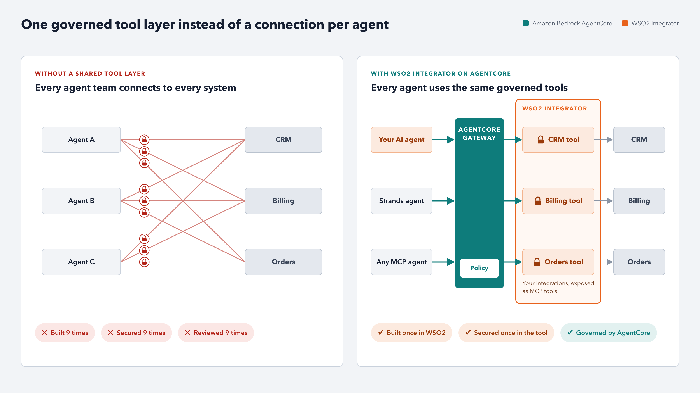
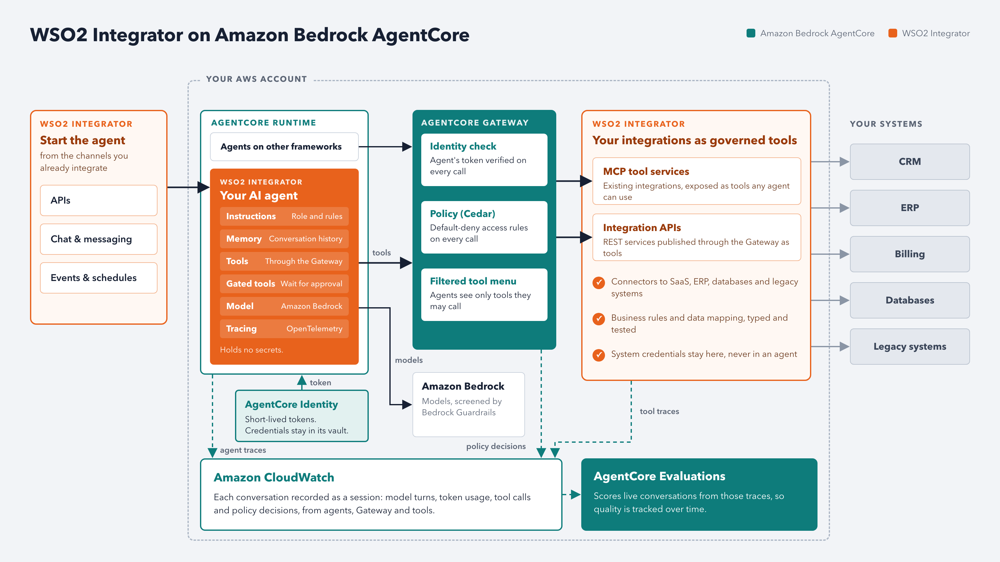

# Your Integrations, Governed for Every Agent: WSO2 Integrator on Amazon Bedrock AgentCore

Enterprise AI agents have a last-mile problem. In the demo, the agent is brilliant. Then it has to issue a real refund, change a real order or read real customer data, and the project stops. Not because the model is wrong, but because nobody can answer three questions with confidence: who is this agent, what is it allowed to touch, and how will we know what it did?

Amazon Bedrock AgentCore answers those questions once, for every agent. WSO2 Integrator answers the one that comes straight after: how does the agent reach the systems that run your business, safely, through integrations you already trust? Together, they take agents from demo to production without starting a new review for every one.

## Why integration is the hard part

An agent creates value when it acts: it issues a credit, updates an order, opens a ticket. Every one of those actions lands in a business system such as billing, the CRM or the order system. Reaching those systems safely takes real work: credentials, data formats, error handling, and the business rules about what is allowed.

In most agent projects, each agent team does that work again for itself. Three agents that need billing means three separate billing connections, each built, secured and reviewed on its own. That repetition is where agent projects slow down, and where risk builds up.

Your integration platform already does this work for the rest of the business. The question is how to let agents use it, under the same governance as everything else.

## Who does what

The two products address different, complementary parts of the problem.

| | WSO2 Integrator | Amazon Bedrock AgentCore |
|---|---|---|
| **Tools** | Turns existing integrations and services into tools any agent can use, with the business logic inside them | Publishes those tools through one governed Gateway |
| **Agents** | Builds agents visually or in code, on the same platform as the integrations | Runs each agent session in its own isolated environment |
| **Control** | Pauses sensitive actions for human approval | Checks every call through the Gateway against central access rules |
| **Credentials** | Agents hold no secrets | Holds credentials in a managed vault and issues short-lived tokens |
| **Record and quality** | Emits OpenTelemetry traces from agents and tools; evaluates agents before release | Collects traces in Amazon CloudWatch; scores live conversations |

## What WSO2 adds as the tool layer

### Your integrations become governed tools for every agent

With WSO2 Integrator, an existing integration can be exposed as a Model Context Protocol (MCP) service, the standard way agents discover and call tools. Placed behind the AgentCore Gateway, it becomes a tool that any authorized agent can use, whether that agent is built with WSO2, Strands Agents or any other MCP-capable framework. Existing REST APIs can be published through the Gateway in the same way.

The connectivity you have already built, approved and operated becomes the agent's toolset. Agent teams use it. They do not rebuild it.

### Deterministic where it matters

An agent decides *what* to do. It should not decide *how* a refund is calculated or which ledger entry it creates. In this architecture the business logic stays in the integration, where it is typed, tested and versioned, and the agent only chooses which tool to call and with what input.

That separation is what makes an agent reviewable. The part that moves money or changes records behaves the same way every time, and it can be tested like any other integration.

### One place to change a system's behaviour

When a back-end system changes, its tool changes once, in one integration. Every agent that uses it picks up the change through the Gateway. There is no list of agent teams to notify and no copies of the same logic to update.

## What WSO2 adds as the agent layer

### Agents and integrations from one team, on one platform

WSO2 Integrator builds agents with the same tools, visual designer and code it uses for integrations: the model, the instructions, the tools and the conversation memory. An integration team can build the agent and the tools it relies on together, and an agent can call an integration as directly as it calls any other tool. The agent's model can run on Amazon Bedrock or be reached through the AgentCore Gateway.

### Humans in the loop where policy is not enough

Some actions should not be forbidden, but should not happen without a person either: a refund above a threshold, a change to a production system. WSO2 Integrator can gate a tool so that the agent pauses before using it, asks for approval, and resumes once a person approves or rejects. With a durable memory store, a paused run survives a restart.

The combination gives two layers of control. AgentCore's access rules define what an agent can never do. Gated tools define what it can do only with a person's approval.

### Quality checked before and after release

WSO2 Integrator turns conversations recorded while building the agent into evaluation sets, so a team can check a new prompt, model or tool against known conversations before it is released. Once the agent is live, AgentCore Evaluations scores real conversations continuously. A change to the agent shows up as a number before it shows up as a complaint.

## What both layers share

### One record of every conversation

Agents and tool services built with WSO2 Integrator emit OpenTelemetry traces, which land in Amazon CloudWatch alongside the Gateway's own record, including its access decisions. Each conversation is recorded as a session, with a trace for every request in it: what was asked, what the model decided, which tools ran, what they returned, how many tokens it used and which rules were applied. Logs carry the same identifiers, so the detail behind any step is one search away.

### No lock-in

An agent or tool service built with WSO2 Integrator is a standard container. The same artifact that runs on AgentCore Runtime can run on Kubernetes, on premises or in another cloud, and the tools can serve agents wherever they run. AgentCore is a choice of where to run and govern, not a rewrite.

## What AgentCore provides

Amazon Bedrock AgentCore is AWS's managed foundation for running agents in production, and it works with any agent framework. The parts this architecture relies on:

- **Runtime** runs each agent session in its own isolated environment.
- **Gateway** is the single, governed entry point to tools and models.
- **Identity** gives each agent an identity and keeps credentials in a vault, so agents receive only short-lived tokens.
- **Policy** checks every call through the Gateway against access rules written in Cedar, a readable policy language your security team can review and version. Under enforcement, an agent can do nothing it has not been granted, and it is shown only the tools it may use.
- **Observability** records traces and logs in Amazon CloudWatch.
- **Evaluations** scores live conversations.

Amazon Bedrock Guardrails can additionally screen what goes into and out of the model.

## Reference architecture

## Where it pays off

**Refunds and credits with a hard ceiling.** The refund logic lives in a tested integration. The agent settles routine requests on its own, a gated tool asks a person to approve larger amounts, and an access rule makes amounts above a ceiling impossible.

**IT operations around the clock.** An agent investigates incidents at any hour using read-only tools built on existing monitoring and service-desk integrations. The tools that change systems are visible only to the on-call engineer's agent, and every action is on the record.

**Agents for partners.** External parties get an agent that can see only the tools published to them, built on the same integrations your own teams use, with every conversation traced and scored.

**Many agents, one set of tools.** Agents built by different teams, with WSO2 and with other frameworks, share one set of WSO2-built tools, one Gateway, one policy language and one record of what happened.

## What to plan for

- **Acting on behalf of a user is not available yet.** Agents built with WSO2 Integrator obtain their own credentials through AgentCore Identity. Delegated access to an individual user's accounts, where the user signs in and approves, is not yet supported.
- **Tools built into an agent sit outside central policy.** Anything that touches customer data or money belongs behind the Gateway.
- **Make the Gateway the only way out.** Run agents in a VPC with outbound traffic restricted to the Gateway and the AWS services they need, so that every call passes through central control.

## Why it matters

Each new agent no longer starts its review from zero. Security reviews one Gateway, one identity model and one set of rules. Operations has one record. The business owner sees quality scores over time, not just individual complaints. And the agents act through integrations the organization already trusts, rather than through new code written for each agent.

## Getting started

Start with one tool service and one agent. Expose an existing integration as an MCP tool behind the AgentCore Gateway, build an agent that uses it, and switch on enforcement with a broad rule first, tightening it one rule at a time. Then bring the trace and the quality scores to your next security review.

- [Build an AI agent with WSO2 Integrator](https://wso2.com/integration-platform/docs/integrator/get-started/quickstarts/build-ai-agent)
- [Deploy an agent built with WSO2 Integrator on Amazon Bedrock AgentCore Runtime](https://wso2.com/integration-platform/docs/integrator/deploy-and-run/self-hosted/containerized-deployment#amazon-bedrock-agentcore-runtime-deployment)
- [Expose an integration as an MCP service](https://wso2.com/integration-platform/docs/integrator/develop-and-test/integration-artifacts/ai-integrations/mcp/exposing-as-mcp)
- [Gate a tool for human approval](https://wso2.com/integration-platform/docs/integrator/develop-and-test/integration-artifacts/ai-integrations/agents/gated-tools)
- [Evaluate agent behaviour](https://wso2.com/integration-platform/docs/integrator/develop-and-test/integration-artifacts/ai-integrations/agents/evaluations)
- [What is Amazon Bedrock AgentCore?](https://docs.aws.amazon.com/bedrock-agentcore/latest/devguide/what-is-bedrock-agentcore.html)

