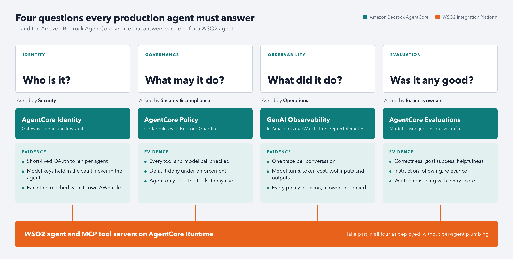
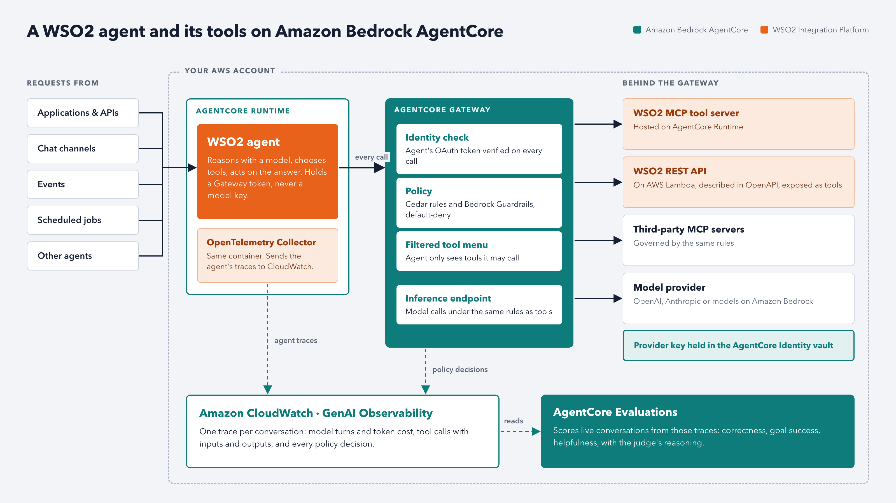
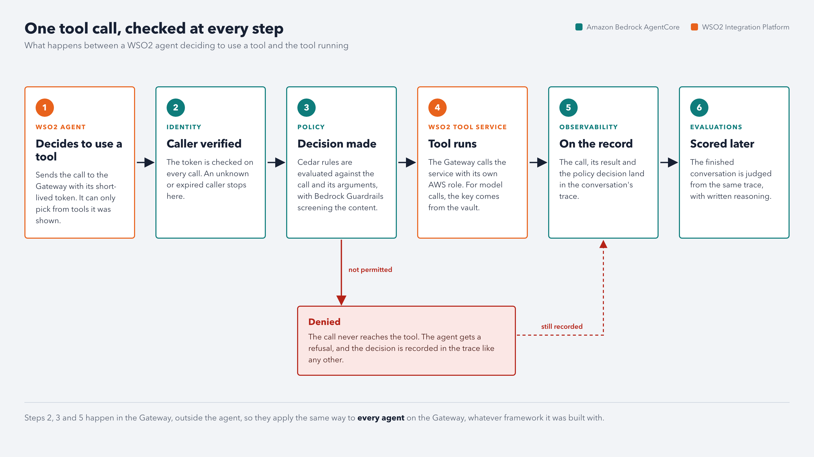

# Every Call Checked, Every Step Seen: Enterprise AI Agents with WSO2 and Amazon Bedrock AgentCore

Building an AI agent is no longer the hard part. Getting one approved for production is.

Before an agent is allowed near customers, money or core systems, it has to pass the same
review as any other business system, and the reviewers ask pointed questions. Security
asks **who the agent is and what it is allowed to touch**. Operations asks **how they
will know what it did** when something goes wrong. The business owner asks **whether its
answers are actually good**, and whether they stay good after the next model or prompt
change.

When every agent team answers those questions its own way, each new agent restarts the
review from zero. Amazon Bedrock AgentCore gives your organization one standard set of
answers, run as managed services in your own AWS account. The WSO2 Integration Platform
lets you build agents and tool services that fit into that standard from day one.
Security, operations and the business can each see the answers for themselves.

## What you get

**Faster approvals.** Identity, access rules, audit trails and quality scores are provided
by the platform rather than built into each agent. The review becomes a look at an
existing standard instead of a new investigation.

**One set of rules for every agent.** Access policies and content guardrails are enforced
centrally, outside the agents. WSO2 agents follow the same rules as agents built on any
other framework, so governance doesn't fragment as the number of agents grows.

**No secrets inside agents.** Model provider keys live in a managed vault. Agents never
hold them, and rotating a key never means redeploying an agent.

**Your existing services become agent tools.** The APIs and integrations you already run
on WSO2 become governed tools with no rewrite, and they bring more than 800 connectors to
your CRM, ERP, service desk and databases with them.

**Full visibility of every conversation.** Each conversation is recorded step by step:
what was asked, what the model decided, which tools ran, what they returned, what it cost
and which rules were applied.

**Quality you can track.** Live conversations are scored continuously, so the business
can see whether a change made the agent better or worse without waiting for complaints.

**An off switch that doesn't need a release.** One access rule stops an agent from calling
its model or any tool as soon as the rule is active. Nothing is redeployed, and the rule
is on the record like every other decision.

**Costs you can see and bound.** Token use is recorded for every conversation and every
step. Rules can cap what a single request may ask for. The Runtime charges for processing
while the agent is working, not while it waits on a model or a tool.

**Freedom of model choice.** The Gateway connects to OpenAI, Anthropic and the models on
Amazon Bedrock, and the same controls apply to model calls whichever provider you choose.

## How it fits together

Amazon Bedrock AgentCore is AWS's managed foundation for running AI agents in production.
It works with any agent framework, and it provides:
- **Runtime:** hosts agents and tool services;
- **Gateway:** a single governed entry point for every tool and model;
- **Identity:** credentials and a key vault;
- **Policy:** access rules and guardrails;
- **Observability:** conversation traces in Amazon CloudWatch;
- **Evaluations:** continuous quality scoring.

**The agent.** A WSO2 agent runs on AgentCore Runtime and handles requests from
applications, chat channels, events, scheduled jobs or other agents.

**Everything it calls goes through the Gateway.** That covers:
- the WSO2 tool services it uses, whether an MCP server hosted on AgentCore or an existing
  REST API;
- third-party tools;
- the language model itself.

**Why that matters.** Because the Gateway is the agent's only route out, it is also the
one place where identity is checked, rules are enforced and every decision is recorded.
It isn't a convention the agent is trusted to follow; it is the only door there is.

## For your security team: identity and control

**Every agent has an identity.** It signs in to the Gateway with a short-lived credential.
The Gateway reaches each tool with its own AWS role, and reaches the model provider with a
key held in AgentCore Identity's vault. The agent's container holds no provider key at
all, which removes a common way credentials leak from AI projects.

**Every conversation is sealed off.** AgentCore Runtime runs each session in its own
micro virtual machine, with its own memory and file system, and clears it when the
session ends. One customer's conversation has no path to another's.

**Every action is checked before it happens.** AgentCore Policy evaluates every tool call
and every model call against rules written in Cedar, a readable policy language your
security team can review, approve and version like any other control. Rules can be broad
("this agent may use the customer lookup tools") or precise ("never more than twenty
records in one request"). Three properties matter:

- **Default-deny.** Under enforcement, an agent can do nothing it hasn't been granted.
- **Restricted tools stay invisible.** An agent is only shown the tools it could be allowed
  to use, so a restricted capability never appears in front of the model.
- **Content guardrails in the same rules.** Amazon Bedrock Guardrails checks for personal
  data, harmful content and prompt attacks can be part of each decision. A request
  carrying a customer's email address can be stopped before it reaches a tool, and a
  tool's answer that exposes personal data can be withheld before the model sees it.

Because the rules sit outside the agent, they also give you an immediate way to stop it.
A single deny rule cuts an agent off from its model and its tools without touching its
code or its deployment.

## For your operations team: a record of everything

Each conversation is recorded in Amazon CloudWatch, its steps tied together by the
conversation's session id. The record shows:
- the request;
- every model turn and its token cost;
- every tool the agent chose, with what went in and what came back;
- every policy decision, whether allowed or denied.

WSO2 agents and WSO2 MCP tool servers report their own side of each step using the
industry-standard OpenTelemetry conventions for generative AI. A slow or unexpected
answer can be traced to the exact step that caused it, and logs carry the same
identifiers, so the full detail is always one step away.

The same record answers the cost question. Token use is captured per model call, so you
can see what a conversation cost, which steps drove it, and how a prompt or model change
moved it. Retention is yours to set, so records are kept as long as your own audit
requirements demand.

## For the business: quality you can measure

AgentCore Evaluations uses those same records to score real conversations, with
model-based judges covering:
- correctness;
- goal success;
- helpfulness;
- instruction following;
- relevance.

Every score comes with the judge's written reasoning, so a drop in quality points to a
cause, not just an alert.

Judges can grade a whole conversation, a single answer, or each tool the agent used:
whether it picked the right one and passed the right inputs.

Quality stops being a one-time pre-launch test. Before a release, run the new build
through a set of test conversations and compare its scores with the version in
production. After the release, the same judges score live traffic, so when the team
changes a prompt, adopts a new model or adds a tool, the effect shows up as a trend line.

The built-in judges cover general quality. For measures only your business can define,
such as following refund policy or using approved wording, you add your own judges: an
AI judge with your instructions and scoring scale, or plain code with your rules.

## Guidance for architects

- **Put anything that needs central control behind the Gateway.** Tools defined inside an
  agent are fast and convenient, but they run outside central policy. Anything touching
  customer data or money belongs behind the Gateway.
- **Choose simple names for Gateway targets**, such as `customerService`. Tool names are
  built from target names, and your access rules refer to them.
- **Keep tracing in the same deployment unit as the agent.** A lightweight OpenTelemetry
  Collector runs alongside the agent in its container and delivers its traces to
  CloudWatch.
- **Give every customer conversation its own session id.** Isolation, memory and the
  conversation record all follow the session, so a shared id merges customers that
  should stay apart.
- **Tag every step with the session id.** Conversation-level scores work with the
  defaults. Scores for individual tool choices need every recorded step to carry the
  conversation's session id.
- **Adopt enforcement in two steps.** Start with a broad permit so existing tools keep
  working, then tighten with specific rules one at a time.

## Where it pays off

**Refunds and credits with a hard ceiling.** An agent settles routine requests on its own.
Amounts above a threshold aren't something it is asked to avoid; the Gateway won't allow
them, and those cases go to a person.

**IT operations around the clock.** An agent investigates incidents with read-only tools
at any hour. The tools that change systems are only visible to the on-call engineer's
agent, and every action is on the record.

**Agents for partners.** External parties get an agent that can only see the tools
published to them, with every conversation traced and scored.

**Many agents, one standard.** Agents built by different teams, on WSO2 and on other
frameworks, share one Gateway, one policy language and one record of what happened.

## Try it

WSO2's agent and MCP building blocks are open source:
- `ballerina/ai`: agents, model providers and tool calling
- `ballerina/mcp`: MCP servers and clients
- `ballerinax/ai.openai` and the other model provider modules
- `ballerina/otel`: OpenTelemetry tracing

Start with one agent and one tool service on AgentCore, switch on enforcement, and bring
the trace and the quality scores to your next security review.
